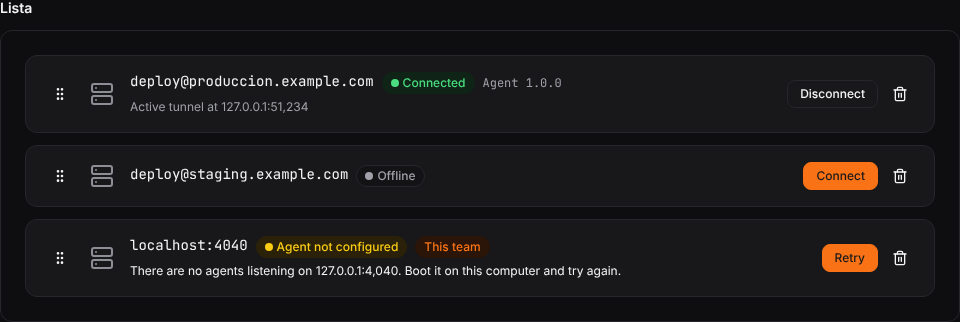
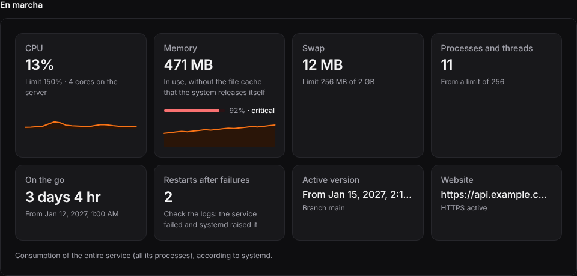
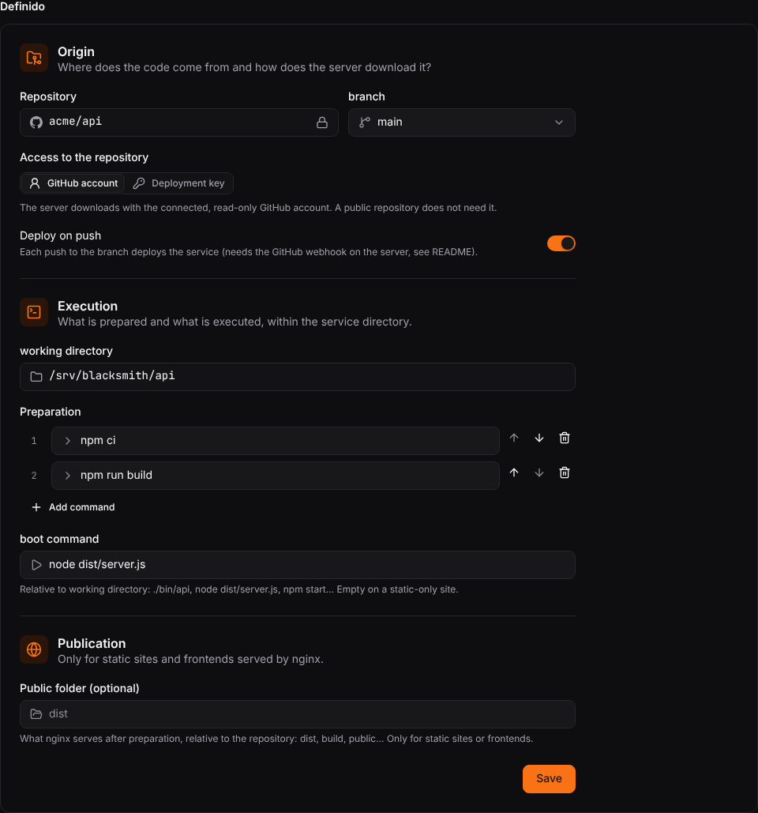
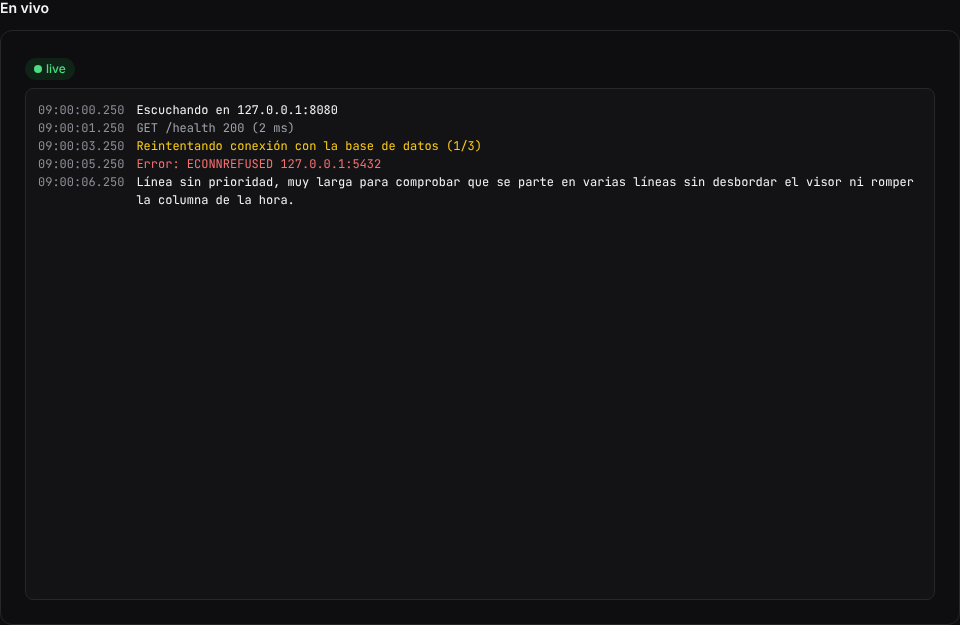

# Blacksmith

[](https://github.com/HormigaDev/blacksmith/actions/workflows/client.yml)
[](https://www.rust-lang.org/)
[](https://svelte.dev/)
[](https://tauri.app/)
[](../LICENSE)

[English](../README.md) | [Español](./README_ESPAÑOL.md) | [Português](./README_PORTUGUÊS.md)

## Índice

- [Por que o Blacksmith existe](#por-que-o-blacksmith-existe)
- [O que ele pode administrar](#o-que-ele-pode-administrar)
- [O que ele deliberadamente não faz](#o-que-ele-deliberadamente-não-faz)
- [Arquitetura](#arquitetura)
- [Capturas de tela](#capturas-de-tela)
- [Início rápido para usuários experientes](#início-rápido-para-usuários-experientes)
- [Guia completo de configuração](#guia-completo-de-configuração)
- [Desenvolvimento](#desenvolvimento)
- [Mapa do repositório](#mapa-do-repositório)
- [Segurança](#segurança)
- [Licença](#licença)
- [Apoie o projeto](#apoie-o-projeto)

Blacksmith é um pequeno painel de controle para desktop e um agente de servidor para implantar
aplicações simples em servidores VPS bare-metal.

Ele foi criado para quem quer a praticidade de um painel de deploy sem transformar um VPS de
4 GB em outro projeto de infraestrutura. O agente é escrito em Rust, roda como um serviço do
systemd e permanece privado no servidor. O cliente desktop chega até ele por um túnel SSH, então
a API de administração não precisa ser exposta à Internet.

O Blacksmith tem um escopo intencionalmente limitado. Ele não é uma PaaS genérica, uma
plataforma de contêineres ou um orquestrador multi-host. Ele administra algumas aplicações em
um servidor sob seu controle usando as ferramentas do sistema que já estão disponíveis.

## Por que o Blacksmith existe

Alternativas self-hosted inspiradas em Heroku ou Vercel podem ser úteis, mas frequentemente
trazem seus próprios bancos de dados, filas, proxies, runtimes de contêineres ou camadas de
orquestração. Em um VPS com 4 GB de RAM e uma vCPU, essa sobrecarga é o orçamento inteiro.

O Blacksmith foi criado para resolver um problema mais simples:

> Implantar e operar alguns projetos de forma confiável sem repetir manualmente os mesmos
> comandos SSH em cada release e sem instalar uma plataforma pesada para fazer isso.

Rust foi escolhido para o agente porque a parte que roda no servidor precisa ser pequena,
previsível e cuidadosa com execução de processos, credenciais, systemd e limites do sistema de
arquivos. O resultado mantém o deploy próximo do host e oferece um fluxo de trabalho desktop
prático.

## O que ele pode administrar

O Blacksmith é adequado para aplicações como:

- Serviços Python gerenciados pelo systemd
- Aplicações e APIs Node.js
- Binários e serviços Rust
- Sites estáticos e frontends compilados
- APIs, serviços WebSocket ou uma aplicação com frontend, API e endpoint WebSocket

Um deploy pode clonar uma branch, executar comandos de preparação, ativar uma nova release,
iniciar o serviço e manter a release anterior para rollback. A saída estática pode ser
publicada pela integração incluída com nginx. Arquivos de ambiente, logs, limites de recursos
e informações básicas do host são administrados pelo mesmo cliente.

## O que ele deliberadamente não faz

O Blacksmith não usa nem administra:

- Docker, Podman, Kubernetes ou outros runtimes de contêineres
- Funções serverless
- Orquestração multi-host
- Aplicações distribuídas complexas
- Um endpoint público de administração
- Um substituto para systemd, nginx, Git ou OpenSSH

A restrição bare-metal faz parte do design, não é uma funcionalidade faltante. Se a aplicação
precisa de service mesh, scheduler distribuído, escalabilidade horizontal automática ou imagens
de contêiner isoladas, o Blacksmith não é a ferramenta certa.

## Arquitetura

O repositório é um workspace Cargo com quatro partes principais:

| Componente | Função |
| --- | --- |
| `agent/` | Serviço Axum e Tokio instalado no VPS |
| `client/` | Interface de usuário SvelteKit |
| `client/src-tauri/` | Runtime desktop Tauri 2 e transporte SSH |
| `shared/` | Tipos de API serializáveis compartilhados pelo agente e cliente |

O agente escuta por padrão em `127.0.0.1:4040`. O aplicativo desktop abre um encaminhamento
local SSH para esse endereço e envia as requisições pelo túnel. O OpenSSH autentica a conexão;
o Blacksmith não adiciona um segundo sistema de login com JWT ou sessões de navegador.

A superfície HTTP pública fica limitada ao endpoint de webhook do GitHub quando os webhooks
estão habilitados. A administração permanece atrás do SSH.

### Modelo de segurança

- O agente não executa comandos da aplicação diretamente; as templates de serviço do systemd
  fazem isso.
- Os serviços das aplicações usam uma conta separada sem privilégios nas instalações de
  servidor.
- systemd e polkit restringem quais unidades o agente pode controlar.
- As credenciais de deploy passam por credenciais do systemd, não por argumentos de linha de
  comando ou URLs de repositório.
- As chaves privadas permanecem no runtime desktop e são armazenadas no cofre de credenciais
  do sistema usando criptografia de envelope.
- Os processos dos serviços ficam confinados ao seu próprio diretório de estado pelo sandbox
  do systemd.
- Os limites de recursos são aplicados ao cgroup do serviço, não apenas ao processo principal.

Revise as templates de deploy e as regras do polkit antes de usar o Blacksmith em um host de
produção. Elas fazem parte da fronteira de segurança.

## Capturas de tela

O repositório inclui as capturas visuais geradas pela suíte de regressão do cliente. Estas são
visões representativas do fluxo de trabalho desktop:









A suíte visual também cobre modo claro, falhas de conexão, confirmação da chave do host,
histórico de deploys, edição do ambiente, limites de recursos, sites nginx e serviços estáticos.

## Início rápido para usuários experientes

### Compilar o agente

O Blacksmith requer Rust 1.97 ou mais recente. O repositório fixa o toolchain em
[`rust-toolchain.toml`](../rust-toolchain.toml).

```sh
git clone https://github.com/HormigaDev/blacksmith.git
cd blacksmith
cargo build --release -p agent
```

O binário gerado é `target/release/blacksmith-agent`.

### Instalar as unidades do servidor

Instale o agente e as templates do systemd como root no VPS. Os caminhos exatos podem ser
adaptados ao host, mas a conta de serviço e os nomes das unidades devem permanecer de acordo
com os arquivos em `deploy/`.

```sh
install -D -o root -g root -m 0755 \
  target/release/blacksmith-agent \
  /opt/blacksmith/bin/blacksmith-agent

install -m 0644 deploy/systemd/*.service /etc/systemd/system/
install -m 0644 deploy/blacksmith.service /etc/systemd/system/
install -m 0644 deploy/polkit/10-blacksmith.rules \
  /etc/polkit-1/rules.d/10-blacksmith.rules

systemctl daemon-reload
systemctl enable --now blacksmith.service
```

A conta de serviço, os diretórios, o arquivo de ambiente, a integração nginx e as credenciais
devem ser preparados conforme os arquivos de deploy e o guia completo abaixo. Não substitua as
regras do polkit por uma entrada ampla no `sudoers`.

### Executar o cliente desktop

```sh
cd client
pnpm install
pnpm tauri dev
```

Adicione o servidor no cliente, aceite sua chave de host na primeira conexão e configure o
repositório e a branch do serviço. Para desenvolvimento local sem VPS, o agente pode usar a
instância systemd do usuário atual:

```sh
BLACKSMITH_SYSTEMD_SCOPE=user cargo run -p agent
```

O modo local não oferece o sandbox do servidor. Use-o somente com repositórios e comandos em
que você confia.

## Guia completo de configuração

### Requisitos

No VPS:

- Um sistema Linux com systemd
- Git
- Agente Blacksmith compilado com Rust
- polkit
- nginx e suporte a ACL ao servir sites estáticos ou proxies reversos
- certbot quando certificados HTTPS forem necessários

No desktop:

- Rust 1.97 ou mais recente
- Node.js 24.14.0
- pnpm 11
- Pré-requisitos do Tauri 2 para sua plataforma

Para desenvolvimento desktop no Linux, instale os pacotes de desenvolvimento GTK 3 e WebKitGTK
4.1 indicados no [guia de pré-requisitos do Tauri](https://v2.tauri.app/start/prerequisites/).

### 1. Criar as contas de serviço

As instalações de servidor usam contas separadas para o agente, os serviços das aplicações e
as operações de fetch. Crie-as uma vez como root:

```sh
for user in blacksmith blacksmith-apps blacksmith-fetch; do
    useradd --system --no-create-home --home-dir /nonexistent \
        --shell /usr/sbin/nologin "$user"
done
```

As unidades versionadas em `deploy/systemd/` documentam a propriedade e os caminhos esperados.

### 2. Instalar e verificar o polkit

```sh
install -o root -g root -m 0644 \
  deploy/polkit/10-blacksmith.rules \
  /etc/polkit-1/rules.d/10-blacksmith.rules

sh deploy/polkit/verify.sh
```

O script de verificação cria unidades de teste temporárias e verifica operações permitidas e
negadas. Um resultado bem-sucedido deve terminar com `regla correcta`.

### 3. Configurar o agente

Copie o template de ambiente e defina os valores apropriados para o host:

```sh
install -d -o root -g blacksmith -m 0750 /etc/blacksmith
install -o root -g blacksmith -m 0640 agent.env /etc/blacksmith/agent.env
```

A configuração usa variáveis `BLACKSMITH_*`. O agente valida variáveis desconhecidas e valores
fora do intervalo na inicialização. Em produção, segredos como o segredo do webhook devem ser
fornecidos por credenciais do systemd, e não por variáveis de ambiente comuns.

### 4. Instalar a integração nginx quando necessário

Para sites e proxies reversos:

```sh
apt install nginx certbot acl
sh deploy/nginx/install.sh
```

O agente gera a configuração nginx a partir de dados de sites validados. Ele suporta raízes
estáticas, upstreams HTTP, WebSockets e HTTPS opcional por meio do certbot. A API de
administração não é publicada por essa configuração.

### 5. Registrar e fazer deploy de um serviço

No cliente desktop:

1. Adicione o VPS e conecte-se por SSH.
2. Registre um serviço com um slug em letras minúsculas.
3. Selecione o repositório e a branch do GitHub.
4. Adicione comandos de preparação como `python -m venv .venv`, `npm ci` ou
   `cargo build --release`.
5. Defina o comando de inicialização do serviço, se ele tiver um processo.
6. Opcionalmente, escolha um diretório público para um site estático.
7. Faça o deploy e verifique o status e os logs do serviço.

Cada deploy recebe seu próprio diretório de release. A release anterior permanece disponível
para rollback quando uma compilação ou a inicialização do serviço falha.

## Desenvolvimento

Na raiz do repositório:

```sh
cargo check --workspace
cargo test -p agent -p shared
cargo clippy -p agent -p shared --all-targets -- -D warnings
```

Para o cliente:

```sh
cd client
pnpm install --frozen-lockfile
pnpm check
pnpm test
pnpm test:e2e:app
```

O fluxo do cliente é executado manualmente pelo GitHub Actions porque suas suítes de navegador
e regressão visual são intencionalmente mais pesadas que uma verificação por commit.

## Mapa do repositório

```text
agent/                 Agente VPS e integração com systemd
client/                Interface SvelteKit, testes e capturas visuais
client/src-tauri/      Runtime desktop Tauri e implementação SSH
shared/                Modelos de API compartilhados em Rust
deploy/                Arquivos de systemd, nginx, polkit e instalação
```

## Segurança

O Blacksmith exige conhecimento cuidadoso de administração de sistemas. Leia a
[política de segurança](../SECURITY.md) antes de implantá-lo em um host de produção. Ela
explica as versões `v1.0.x` com suporte, o processo privado para reportar vulnerabilidades e a
responsabilidade do operador de configurar corretamente SSH, systemd, polkit, credenciais,
firewall e comandos de deploy.

## Licença

O Blacksmith é distribuído sob a [Licença MIT](../LICENSE).

## Apoie o projeto

Se o Blacksmith economiza seu tempo ou torna um VPS pequeno mais prático, você pode apoiar sua
manutenção contínua:

[](https://www.paypal.com/donate/?hosted_button_id=UCL7EE2G44KPQ)
